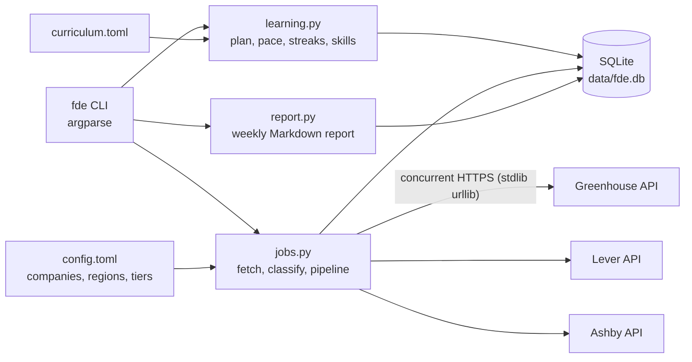

# FDE Coach

[](https://github.com/rakshith-ponnappa/fde-coach/actions/workflows/ci.yml)


[](LICENSE)

A **zero-dependency Python CLI** for engineers moving into **Forward Deployed Engineer (FDE)** and AI
platform roles. It combines three things you'd otherwise juggle in spreadsheets:

1. **A 26-week curriculum**: a 16-week sprint from "new to Python" to job-ready, then a 10-week depth track ([overview](docs/CURRICULUM.md)).
2. **A daily coach**: today's plan, study-hour logging, streaks, skill ratings and weekly progress reports.
3. **A job finder**: polls the public job-board APIs of 87 AI companies (Greenhouse, Lever, Ashby), ranks roles into tiers, filters by region and flags visa-sponsorship wording.

Everything runs on the Python standard library and stores data in a local SQLite file.

```text
$ fde today --offline
FDE COACH | Tue 17 Nov 2026 | day 43 of your plan
Pace: 6 weeks behind | streak 1 days | this plan-week 0.0/28 h | total 3 h | weeks done 0/26

WEEK 1: Setup + Python basics: functions, variables, conditionals, loops   (phase 1: Python fast track)
Goals:
  - CS50P lectures 0-2 (functions & variables, conditionals, loops) and their problem sets
  ...
TODAY'S 4-HOUR SESSION
  0:00-1:30  LEARN     this week's main resource; pause videos and type every example yourself
  1:40-3:10  BUILD     exercises / this week's deliverable (Copilot inline suggestions OFF while learning)
  3:20-3:45  PRACTICE  1 Exercism Python exercise (or redo a CS50P problem from memory)
  ...
```

## Architecture



## Features

- **Curriculum as data:** phases, weeks, goals, resources and deliverables live in `curriculum.toml`, and a unit test checks it stays consistent.
- **Daily plan and pacing:** works out your current week, whether you're ahead or behind, and your study streak.
- **Skill tracking:** rate 21 skills from 0 (none) to 5 (expert) against targets.
- **Job finder:**
  - Fetches 87 company boards concurrently over public, unauthenticated endpoints.
  - **Tiers** roles by title regex (A: FDE/deployment, B: applied AI and AI platform, C: platform/SRE/DevOps) and excludes junior or irrelevant titles.
  - **Region filter** with configurable regexes, plus remote-role handling.
  - **Visa-sponsorship hint**, judged sentence by sentence ("we do sponsor visas" means yes, "unable to offer sponsorship" means no).
  - **Pipeline tracking** from new to shortlisted, applied, interviewing and offer, with notes.
  - **Market pulse:** which skills recent FDE-style job ads ask for.
  - Builds LinkedIn search links for you to open yourself. Nothing is scraped.
- **Reports:** `fde report --write` saves a dated Markdown progress report.

## Quickstart

Python 3.11 or newer is the only requirement.

```sh
git clone https://github.com/rakshith-ponnappa/fde-coach.git
cd fde-coach
cp config.example.toml config.toml   # optional: your regions/companies (config.toml is git-ignored)
./fde init                           # start the 26-week plan today
./fde today                          # today's plan (also checks job boards once a day)
./fde log 4 "FastAPI tutorial"       # log study hours
```

To run it from anywhere, add `alias fde="/path/to/fde-coach/fde"` to your shell profile.

## Commands

| Command | What it does |
|---|---|
| `fde today [--offline]` | Today's plan; checks job boards once a day unless `--offline` |
| `fde init [--start YYYY-MM-DD]` | Set or change the day your plan started |
| `fde log HOURS ["note"] [--date]` | Log study time |
| `fde week show [N]` / `fde week done [N] [--note]` | Show a week, or mark it done with what you shipped |
| `fde plan` | The whole week-by-week plan with your progress |
| `fde skills [show]` / `fde skills set KEY LEVEL` | Show or rate skills |
| `fde jobs fetch` | Check all company job boards now |
| `fde jobs list [--tier A] [--region uk] [--new DAYS] [--status S]` | Stored jobs, best matches first |
| `fde jobs show ID [--full]` | Details and link for one job |
| `fde jobs add COMPANY TITLE URL` | Track a job you found yourself |
| `fde jobs apply ID [--note]` / `fde jobs status ID STATUS` | Move a job through your pipeline |
| `fde jobs skills [--days 30]` | Skills that recent FDE-style ads ask for |
| `fde jobs links` | LinkedIn and job-site searches to open yourself |
| `fde report [--write]` | Progress report (optionally saved to `reports/`) |

## Configuration

`config.example.toml` is a fully commented, working example. Copy it to `config.toml` (git-ignored) to
change it. Until `config.toml` exists, the coach reads the example file.

| Section | Purpose |
|---|---|
| `companies` | `{ name, ats, slug }` entries, where `ats` is `greenhouse`, `lever` or `ashby` |
| `[search]` | Preferred on-site regions and whether to keep remote roles |
| `[regions]` | Regexes that map location strings to regions |
| `[tiers]` | Title regexes for tiers A, B and C, plus `exclude` |
| `[skill_keywords]` | Regexes counted by `fde jobs skills` |
| `[linkedin]`, `[[links]]` | Search links built by `fde jobs links` |

### How the job finder behaves

- Only **public job-board APIs** are used (`boards-api.greenhouse.io`, `api.lever.co`, `api.ashbyhq.com`): no logins, no scraping, no browser automation.
- Each board is fetched at most once per `fde today` (once a day) or when you run `fde jobs fetch`.
- Data stays on your machine in `data/fde.db`.

## Testing

```sh
python3 -m unittest discover -v
```

The suite (32 tests) runs offline. HTTP is mocked and temporary directories are used. It covers the
ATS parsers, tiering, region filters, sponsorship detection, pacing and streak maths, the CLI, and
curriculum consistency.

## Project layout

```text
fde                   launcher script (adds the repo to PYTHONPATH)
fde_coach/cli.py      argparse commands
fde_coach/learning.py plan, pace, streaks, skills
fde_coach/jobs.py     ATS fetchers, classification, sponsorship, pipeline
fde_coach/report.py   Markdown progress report
fde_coach/store.py    SQLite schema and TOML loading
curriculum.toml       the 26-week plan
config.example.toml   companies, regions, tiers, keywords
docs/CURRICULUM.md    readable curriculum overview
tests/                offline unittest suite
```

## Design decisions

- **Standard library only.** It installs nowhere and breaks never: `urllib`, `sqlite3`, `tomllib`,
  `argparse` and `concurrent.futures` cover everything a personal CLI needs.
- **Plans and filters are data, not code.** The curriculum and job filters are TOML, so you can
  adapt them to your own path without touching Python.
- **SQLite for state.** It's a single portable file with real queries for the pipeline and reports.
- **Respectful by default.** Public APIs only, no scraping, and links to open yourself for sites
  that don't offer an API.

## Roadmap

- [ ] More ATS providers (Workable, SmartRecruiters)
- [ ] Export the pipeline to CSV or a calendar
- [ ] Optional LLM summary of matching job descriptions against your skills

## License

[MIT](LICENSE)
